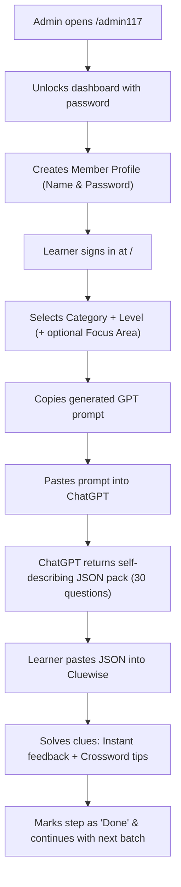

# Cluewise — Application Overview, Architecture & User Flow

> A compact reference guide to **Cluewise: Business & Economics Crossword Vocabulary Companion**.

---

## 1. What is Cluewise?

**Cluewise** is a lightweight, responsive learning companion designed to help learners master business, finance, management, and economics terminology through crossword-style clues.

- **Non-Numerical**: 100% conceptual and vocabulary-driven; zero mathematical calculations.
- **Crossword Connections**: Every question links directly to how the term is framed in crossword puzzles.
- **Deep Exploration**: Every question includes a ready-to-copy GPT prompt for further research.
- **Private Learning Spaces**: Fully isolated accounts where each learner's progress, attempts, and custom question packs stay private.

---

## 2. Roles & URL Routing

| Route | Role | Description |
|---|---|---|
| **`/`** | **Member Learning Portal** | Clean sign-in screen for learners. Once signed in, displays the member's private learning library and clue explorer. |
| **`/admin117`** | **Secret Admin Console** | Password-protected portal (`ADMIN_PASSWORD`, default: `12345`). Used to create learner accounts, assign passwords, and monitor member counts. |
| **`/api/*`** | **Serverless API** | Session verification, member authentication, and Turso cloud database synchronization. |

---

## 3. End-to-End User Flow



1. **Member Provisioning**: Administrator opens `/admin117`, unlocks the console, and adds a member (e.g. `krishna` with a private password).
2. **Member Sign-In**: Learner visits `/`, signs in with their assigned name and password, entering their private learning space.
3. **Prompt Generation**: In the **Import JSON** modal, the learner selects a **Category**, **Learning Level**, and an optional **Focus Area**, then copies the auto-generated prompt.
4. **GPT Planning & Generation**: Learner pastes the prompt into ChatGPT. GPT acts as an expert curriculum planner, divides the topic into ~30-question batches, and generates Batch 1 in self-describing JSON format.
5. **Direct Import**: Learner pastes the JSON code block into Cluewise. The system parses the curriculum plan, maps domains, strips clue letter-counts, and saves the set to the member's database profile.
6. **Interactive Clue Solving**:
   - 4 multiple choice options with immediate validation.
   - Clear explanations and crossword indicator tips.
   - Visual badges for cross-category supporting concepts (`🔗 From: <Category>`).
   - One-click copy for deeper GPT exploration prompts.
   - The **"Done"** button activates once the final clue in the set is answered.
7. **Curriculum Continuity**: To continue learning, the user prompts GPT with `"Continue with the next batch"`, importing subsequent batches into the same sequence.

---

## 4. Input Fields & Dropdown Options

### Section A — Prompt Generator Inputs
- **Category (Required)**: 40 specific categories across 6 domains (see Section 5 below).
- **Learning Level (Required)**:
  - `Beginner` — Core terminology, direct definitions, basic crossword clues.
  - `Intermediate` — Relationships, distinctions, similar terms, cause-and-effect.
  - `Advanced` — Subtle distinctions, indirect definitions, strategic applications.
  - `Mastery` — Abstract clues, edge cases, multi-concept associations.
- **Focus Area (Optional)**:
  - *Leave blank*: GPT plans and covers the full breadth of the selected category.
  - *Enter a topic (e.g. "Demand and Supply")*: GPT restricts the curriculum strictly to that specific sub-topic.

### Section B — JSON Import Area
- **JSON Input Box**: Textarea accepting a single fenced ```json code block generated by GPT. No manual metadata inputs required.

---

## 5. Curriculum Catalogue (6 Domains · 40 Categories)

Learning content strictly follows a 4-tier hierarchy:
$$\textbf{Domain} \longrightarrow \textbf{Category} \longrightarrow \textbf{Subcategory} \longrightarrow \textbf{Batch}$$

| Domain | Selectable Categories (40 Total) |
|---|---|
| **Domain A — Economics** | Economic Fundamentals · Goods & Services · Factors of Production · Demand & Supply · Economic Systems · Market Structures · Economic Indicators · Business Cycles · Economic Policies · International Trade |
| **Domain B — Business Fundamentals** | Business Terminology · Business Organisation · Business Functions · Business Ownership · Business Environment |
| **Domain C — Marketing & Commerce** | Marketing Fundamentals · Pricing Terminology · Branding & Advertising · Consumer Behaviour · Retail & Distribution · Sales Terminology |
| **Domain D — Entrepreneurship & Startups** | Entrepreneurship · Startup Terminology · Business Models · Startup Funding · Business Strategy · Innovation |
| **Domain E — Business Management** | Management Fundamentals · Human Resources · Leadership · Operations · Finance Terminology · Accounting Concepts · Business Communication |
| **Domain F — Commerce & Trade** | Banking & Financial Services · Insurance Terminology · Capital Markets · E-Commerce · Legal & Regulatory Aspects · Global Business & Trade |

---

## 6. Cross-Category Knowledge Relationships

To prevent categories from becoming isolated silos, Cluewise classifies concepts into three types:

1. **Core Concepts**: Directly belong to the selected category (e.g. *Scarcity* in *Economic Fundamentals*). These receive ~85–90% of questions.
2. **Supporting Concepts**: Borrowed from neighbouring categories (e.g. *Demand* in *Economic Fundamentals*). Tagged with `concept_scope: "supporting"` and display a `🔗 From: <Category>` badge.
3. **Extended Concepts**: Peripheral concepts referenced in explanations or deeper prompts without creating separate batches.

### Curriculum Isolation Rule
Introducing a supporting concept (e.g. *Demand* while studying *Economic Fundamentals*) does **not** count towards completing the core curriculum of *Demand & Supply*. When *Demand & Supply* is studied later, its curriculum is taught fully from foundational principles.

---

## 7. Supported Question Types (15 Canonical Types)

1. `definition_to_term` — Clue or definition; answer is the economic term.
2. `term_to_definition` — Economic term provided; answer is its definition.
3. `fill_in_the_blank` — Missing term in a standard business sentence.
4. `concept_identification` — Identifying underlying principle from a scenario.
5. `difference_identification` — Distinguishing between two similar concepts.
6. `similar_terms` — Identifying synonyms in crossword vocabulary.
7. `classification` — Grouping concepts (e.g. consumer good vs capital good).
8. `odd_one_out` — Spotting the term that does not belong.
9. `scenario_identification` — Real-world business context.
10. `concept_association` — Linking two interconnected terms.
11. `acronym_recognition` — Standard economic/business abbreviations.
12. `statement_based` — Selecting the true/false statement about a term.
13. `cause_and_effect` — Outcomes resulting from economic actions.
14. `crossword_clue_interpretation` — Direct analysis of crossword clue wordplay.
15. `case_study` — Applied mini-scenario question.

---

## 8. Canonical JSON Schema Reference

```json
{
  "metadata": {
    "domain": "Economics",
    "category": "Economic Fundamentals",
    "subcategory": "Basic Economic Concepts",
    "batch_title": "Meaning, Scarcity and Choice",
    "focus_area": "",
    "level": "beginner",
    "pack_id": "ECO-EF-BEG-001",
    "batch": 1,
    "total_batches": 4,
    "level_status": "in_progress",

    "curriculum_plan": {
      "planned_batches": [
        {
          "batch": 1,
          "title": "Meaning, Scarcity and Choice",
          "subcategory": "Basic Economic Concepts",
          "concepts": ["scarcity", "choice"],
          "supporting_concepts": [
            { "concept": "demand", "source_category": "Demand & Supply" }
          ]
        }
      ]
    },

    "batch_concepts": ["scarcity", "choice"],
    "concepts_covered": ["scarcity", "choice"],
    "concepts_remaining": ["utility", "opportunity-cost"],
    "supporting_concepts_covered": [
      { "concept": "demand", "source_category": "Demand & Supply" }
    ]
  },

  "questions": [
    {
      "id": "ECO-EF-BEG-001-01",
      "type": "definition_to_term",
      "concept": "Scarcity",
      "concept_scope": "core",
      "question": "Which condition arises because human wants exceed finite resources?",
      "options": ["Scarcity", "Surplus", "Abundance", "Inflation"],
      "answer": "Scarcity",
      "explanation": "Scarcity is the fundamental economic problem requiring trade-offs.",
      "crossword_clue": "Universal condition of limited productive resources.",
      "deeper_prompt": "Explain scarcity, its role in economics, and common crossword clues."
    },
    {
      "id": "ECO-EF-BEG-001-02",
      "type": "definition_to_term",
      "concept": "Demand",
      "concept_scope": "supporting",
      "related_category": "Demand & Supply",
      "question": "What term describes consumer willingness and financial ability to buy goods?",
      "options": ["Demand", "Supply", "Utility", "Elasticity"],
      "answer": "Demand",
      "explanation": "Demand in economics refers to effective demand backed by purchasing power.",
      "crossword_clue": "Consumer desire for a product backed by ability to pay.",
      "deeper_prompt": "Explain demand, its determinants, and common crossword clues."
    }
  ]
}
```

---

## 9. Key UI Features & Navigation

- **File Tree Explorer**: Desktop left sidebar displaying all 40 categories organized into expandable folders with batch count badges.
- **Mobile Off-Canvas Drawer**: Slide-out drawer on mobile triggered by the `☰ Explorer` button with a dimmed backdrop and smooth swipe transition.
- **Live Search & Filter**: Real-time filtering by category, level, or search keyword.
- **Done Step Button**: Dynamically activates once the final clue in a set is answered, updating the batch status to `✓ COMPLETED`.
- **Log out Button**: In the top navigation bar, allowing learners to sign out safely so another member can use the device.

